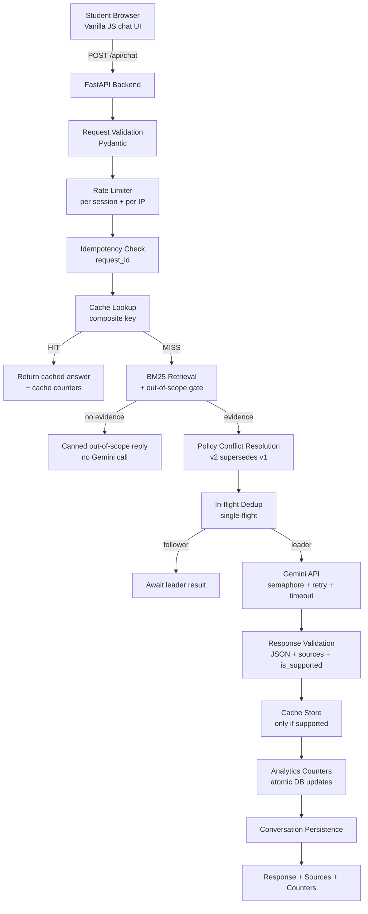

# DPM-101 Course Helpdesk Chatbot

An AI-powered course Q&A assistant for **IIMBx DPM-101 (Digital Product Management)**.
Students ask questions in a chat interface; the backend retrieves evidence from the
official course documents in `course_docs/`, resolves policy conflicts in code
(not by LLM judgment), and grounds every answer through the Google Gemini API.

Built for exam-week traffic (~1,500 students) with aggressive caching,
single-flight request deduplication, bounded Gemini concurrency, and live
usage analytics.

---

## 1. Project Overview

| | |
|---|---|
| **What it does** | Answers student questions strictly from the 4 official course documents |
| **Knowledge base** | `course_docs/*.txt` (immutable, supplied files — never modified) |
| **LLM** | Google Gemini Flash (`GEMINI_MODEL` env var, default `gemini-3.8-flash`) |
| **Retrieval** | In-house BM25 (explainable, no vector DB, no embedding API) |
| **Persistence** | PostgreSQL via `DATABASE_URL`, SQLite fallback for local dev |
| **Tests** | 108 automated tests (Gemini fully mocked) |

Key behaviours:

- **Accurate** — answers cite their source document filenames.
- **Conflict-aware** — Version 2 grading policy supersedes Version 1 in code.
- **Injection-safe** — the prompt-injection attempt embedded in the student
  forum section of `04_exam_rules_and_faq.txt` is detected and excluded from
  the index; the system instruction also forbids following document-embedded
  instructions.
- **No hallucinations** — out-of-scope questions never reach Gemini; unsupported
  Gemini output is never cached or presented as fact.
- **Efficient** — repeated questions served from a persistent cache; concurrent
  identical questions trigger exactly one Gemini request.

Full corpus analysis (conflicts, precedence, ambiguities, must-answer facts)
lives in [`docs/DOCUMENT_ANALYSIS.md`](docs/DOCUMENT_ANALYSIS.md).

## 2. Architecture



Request pipeline in `app/api/chat.py` (11 steps):

0. Rate-limit check (per session + per IP)
1. Idempotency — duplicate `request_id` → return last answer, no re-counting
2. Session/conversation history (last 10 turns)
3. Cache lookup → immediate return on hit
4. BM25 retrieval + **out-of-scope gate** (term-coverage + score threshold)
5. Out-of-scope → canned response, **zero Gemini calls**
6. Single-flight dedup — concurrent identical requests share one future
7. Gemini call (leader only) — semaphore, timeout, retry with backoff
8. Response validation (JSON, sources, `is_supported`)
9. Cache store (only validated, evidence-supported responses)
10. Analytics counters (atomic DB increments)
11. Conversation turn persistence

### Project structure

```
helpdesk-chatbot/            (D:\iimbX_assing)
├── app/
│   ├── main.py             FastAPI entry point, lifespan, CORS, routers
│   ├── config.py           Env-driven settings (cached singleton)
│   ├── api/                chat.py, stats.py, health.py
│   ├── schemas/chat.py     Pydantic request/response models
│   ├── services/
│   │   ├── document_service.py    Ingestion, chunking, SHA-256 fingerprinting
│   │   ├── retrieval_service.py   BM25 index + out-of-scope gate
│   │   ├── policy_service.py       Document authority + conflict resolution
│   │   ├── gemini_service.py      Gemini client, retry, validation
│   │   ├── cache_service.py       Persistent response cache
│   │   ├── inflight_service.py    Single-flight deduplication
│   │   ├── conversation_service.py Session & history management
│   │   ├── analytics_service.py  Atomic DB counters
│   │   └── rate_limit_service.py Sliding-window rate limiting
│   ├── database/           connection.py (engine/session), models.py (5 tables)
│   └── static/             index.html, style.css, app.js (frontend)
├── course_docs/            4 immutable official course documents
├── docs/DOCUMENT_ANALYSIS.md
├── tests/                  8 test modules, 108 tests (Gemini mocked)
├── scripts/live_integration.py   Controlled manual live test (real Gemini)
├── ai_sessions/            Genuine AI session exports (see its README)
├── .env.example            Documented configuration template
├── render.yaml             Render.com deployment config
├── requirements.txt
└── README.md
```

## 3. Technology Stack

- **Python 3.11**, FastAPI 0.115, Uvicorn, Pydantic v2
- **Google Gemini** via the official `google-genai` SDK (model configurable via `GEMINI_MODEL`)
- **SQLAlchemy 2** ORM — PostgreSQL (`DATABASE_URL`) or SQLite fallback (WAL mode)
- **In-house BM25** (k1=1.5, b=0.75) — zero extra dependencies, fully explainable
- **pytest** + FastAPI `TestClient` — all AI calls mocked
- **Frontend:** plain HTML/CSS/vanilla JS (responsive)

## 4. RAG Implementation

**Ingestion** (`app/services/document_service.py`, at startup):
1. Read every `.txt` from `course_docs/` (filenames preserved).
2. Split at numbered section headings; large sections sub-chunked (~500 chars)
   at paragraph/sentence boundaries; headings preserved per chunk.
3. SHA-256 fingerprint per document + a corpus fingerprint — used for cache
   keying and invalidation when documents change.
4. Chunks flagged non-authoritative (student forum / prompt-injection content)
   are excluded from the BM25 index entirely.

**Retrieval** (`app/services/retrieval_service.py`):
- **The question is the primary query** — BM25 runs on the question alone, so
  a new topic asked mid-conversation retrieves its own chunks instead of the
  chunks matching earlier turns (context terms would otherwise drown the
  question and produce "not mentioned" answers).
- **Anaphoric follow-up fallback** — when the question alone has no strong
  lexical anchor (`RETRIEVAL_ANCHOR_MIN_SCORE`, e.g. *"What happens if I miss
  it?"*), retrieval retries with the compact conversation context prepended
  so the referent's terms guide BM25.
- **Out-of-scope gate** — a question is answerable only when ≥
  `RETRIEVAL_MIN_TERM_COVERAGE` (default 30%) of its *own* contentful terms
  exist anywhere in the corpus; conversation context does not count toward
  coverage, so a long course conversation cannot make an off-topic question
  look in-scope. Short questions (≤3 contentful terms) whose missing
  referent an on-topic conversation may supply are treated as possible
  follow-ups. Chunks must also clear `RETRIEVAL_MIN_SCORE`.
- Over-fetch (3× top-k), filter by score, keep top-k, then **drop superseded
  sources** and assemble a concise evidence context with a policy preamble.

The index is built once at startup and reused — never rebuilt per request.

## 5. Document Conflict Resolution Strategy

Conflict resolution is **deterministic code, not an LLM decision**
(`app/services/policy_service.py`):

| Document | Authority | Rationale |
|---|---|---|
| `03_grading_policy_v2.txt` | 100 | Explicit superseding statement, "CURRENT ACTIVE POLICY" status |
| `04_exam_rules_and_faq.txt` §1–2 | 90 | Official exam rules, most recently updated |
| `01_course_handbook.txt` | 80 | Official structural facts, no conflicts |
| `02_grading_policy_v1.txt` | 10 | Explicitly superseded; historical reference only |
| Doc 04 §3 (student forum) | 0 | "Not official course policy" — contains a prompt-injection attempt |

Mechanisms:
- **Topic-keyword supersession** — v1 is marked superseded for
  passing/score/late-submission/capstone topics and removed from the evidence
  context; a policy note is injected into the prompt instead.
- **Both-docs rule** — if v1 and v2 are ever retrieved together, v1 is
  demoted automatically.
- **Ambiguity disclosure** — refund questions are flagged: the documents
  contain no refund policy, so the assistant states that plainly instead of
  guessing.
- **Injection defence (layered):** (1) forum chunks are excluded from the
  index; (2) the immutable system instruction forbids following
  document-embedded instructions; (3) only `.txt` course-doc filenames are
  accepted as sources.

The registry (`DOCUMENT_AUTHORITY`, `SUPERSEDING_MAP`, `SUPERSEDED_TOPICS`)
is plain, documented, configurable Python — see
[`docs/DOCUMENT_ANALYSIS.md`](docs/DOCUMENT_ANALYSIS.md) for the derivation
from the documents' own metadata and language.

## 6. Cache Design

Persistent, DB-backed (`cached_responses` table):

- **Composite key** = SHA-256 of `normalized question | conversation-context
  summary | corpus fingerprint | policy config version | Gemini model` — so a
  doc edit, policy-config change, or model change can never serve stale
  answers.
- **Normalization:** lowercase, trim, collapse whitespace, fold curly
  quotes/apostrophes.
- **Context-aware:** the last conversation turns are part of the key, so the
  same words asked in *different* conversational contexts are not conflated;
  context-free repeats *are*. Trailing turns that merely repeat the current
  question are excluded from the key, so asking the same question again
  (same session, any capitalization/spacing) hits the entry created by the
  earlier ask — while a question re-asked after *other* turns stays
  context-distinct.
- **Only validated, evidence-supported responses are cached** — never API
  errors, out-of-scope replies, or `is_supported=false` output.
- **TTL:** `CACHE_TTL_SECONDS` (default 24 h), enforced on read; expired and
  fingerprint-stale entries are purged at startup; cache size is capped at
  `MAX_CACHE_ENTRIES` (oldest entries evicted).
- **Cache hits increment `total_questions` and `cache_hits` — never
  `gemini_api_calls`.**

## 7. Duplicate Request Protection

**Frontend** (`app/static/app.js`): Send button disabled + `pending` flag while
a request is in flight; loading indicator; Enter sends, Shift+Enter inserts a
newline; unique `request_id` per submission.

**Backend** (`app/api/chat.py`):
- **Idempotency** — `processed_requests` table keyed by unique `request_id`.
  Replays return the session's last assistant message with
  HTTP 200 and **no counter changes**. The insert's unique constraint also
  guards the concurrent same-ID race (IntegrityError → idempotent response).
- **Single-flight** (`app/services/inflight_service.py`) — in-flight key =
  the cache key; the first caller becomes the *leader* and performs the one
  Gemini call; concurrent identical callers become *followers* awaiting a
  shared `asyncio.Future`. If 20 students submit the same question
  simultaneously, **one** Gemini request is made and every waiter gets the
  same validated result. Followers are still each counted as accepted
  questions.
- **Rate limiting** (`app/services/rate_limit_service.py`) — sliding window
  per `session_id` (`RATE_LIMIT_REQUESTS`, default 60/min) and per client IP
  (`RATE_LIMIT_IP_REQUESTS`, default 300/min, generous for shared campus
  NATs). Blocked requests get HTTP 429 + `Retry-After`.

## 8. Gemini Rate-Limit & Error Handling

`app/services/gemini_service.py`:

- **Bounded concurrency** — `asyncio.Semaphore(MAX_CONCURRENT_GEMINI)`,
  default 5 parallel outbound calls.
- **Timeouts** — `GEMINI_TIMEOUT_SECONDS` (default 30 s) per attempt.
- **Retries** — up to `GEMINI_MAX_RETRIES` (default 3) with **exponential
  backoff + jitter**; a server-provided **Retry-After hint is respected**
  when the SDK exposes one (capped at 60 s).
- **Error translation** — 429/quota → rate-limit error (retry), 401/invalid
  key → configuration error (**never retried**), 500/503 → unavailable
  (retry). Permanent client errors are not retried.
- **Friendly messages** — 429: *"Our course assistant is receiving many
  requests right now…"*, timeout: *"The assistant is taking longer than
  expected…"*, unavailable: *"…temporarily unavailable. Your question has
  not been lost."* — never API keys, stack traces, or internal details.
- **Validation** — responses must parse as JSON (`answer`, `sources`,
  `is_supported`); code fences are tolerated; sources filtered to real
  `.txt` filenames; unsupported output returns a safe fallback and is
  never cached.

The SDK's blocking call runs in a thread pool so the event loop is never blocked.

## 9. Analytics Definitions

`GET /api/stats` returns counters stored as **database-backed atomic
updates** (single-row `app_counters` table, `UPDATE ... SET x = x + 1`):

| Counter | Definition |
|---|---|
| `total_questions` | Unique accepted student questions processed |
| `gemini_api_calls` | Actual outbound Gemini generation requests, **including retries** |
| `cache_hits` | Accepted questions answered from the cache |

Rules enforced: cache hit → `total_questions` + `cache_hits`; successful
Gemini answer → `total_questions` + `gemini_api_calls`; failed Gemini attempt
→ `gemini_api_calls` (per attempt) but no cache hit; duplicate idempotency-key
replays change nothing; concurrent identical questions each count once while
only one shared Gemini request is counted. The frontend polls the backend
every 15 s — no browser-local values.

## 10. Local Installation

```bash
# Python 3.11+
python -m venv .venv
# Windows:
.venv\Scripts\activate
# macOS/Linux:
source .venv/bin/activate

pip install -r requirements.txt

cp .env.example .env         # then edit GEMINI_API_KEY
# Windows: copy .env.example .env

uvicorn app.main:app --reload --port 8000
```

Open <http://localhost:8000> — interactive API docs at `/docs`.

> Without a real `GEMINI_API_KEY` the app still boots and answers
> out-of-scope/cached questions; Gemini-backed answers return the friendly
> "not properly configured" message.

## 11. Environment Variables

See [`.env.example`](.env.example) for the full annotated list. Highlights:

| Variable | Default | Purpose |
|---|---|---|
| `GEMINI_API_KEY` | — | **Required.** Never hardcode, never commit |
| `GEMINI_MODEL` | `gemini-3.8-flash` | Any available Gemini Flash model |
| `DATABASE_URL` | SQLite `./dpm101_helpdesk.db` | PostgreSQL for production |
| `CORS_ORIGINS` | `*` | Comma-separated origins (`*` = dev convenience) |
| `CACHE_TTL_SECONDS` / `MAX_CACHE_ENTRIES` | 86400 / 5000 | Cache lifetime & size cap |
| `MAX_CONCURRENT_GEMINI` | 5 | Outbound Gemini concurrency |
| `GEMINI_TIMEOUT_SECONDS` / `GEMINI_MAX_RETRIES` / `GEMINI_RETRY_BASE_DELAY` | 30 / 3 / 1.0 | Resilience tuning |
| `RETRIEVAL_TOP_K` / `RETRIEVAL_MIN_SCORE` / `RETRIEVAL_MIN_TERM_COVERAGE` / `RETRIEVAL_ANCHOR_MIN_SCORE` | 5 / 0.05 / 0.3 / 1.0 | Retrieval, out-of-scope & follow-up tuning |
| `MAX_CONVERSATION_TURNS` / `MAX_MESSAGE_LENGTH` | 10 / 2000 | Conversation limits |
| `RATE_LIMIT_REQUESTS` / `RATE_LIMIT_WINDOW_SECONDS` / `RATE_LIMIT_IP_REQUESTS` | 60 / 60 / 300 | Sliding-window limits |

## 12. Testing

```bash
python -m pytest tests/ -v
```

108 tests across 8 test modules — **no live Gemini calls** (the AI service is
mocked; factual correctness is verified via retrieval + policy layers):

| Module | Covers |
|---|---|
| `test_chat.py` | All 12 sample questions, follow-up conversations, session isolation, input validation |
| `test_cache.py` | Normalization, key composition, same-session + cross-session repeats, fingerprint-change invalidation, duplicate IDs |
| `test_concurrency.py` | Single-flight leader/follower, one Gemini call for N concurrent identical requests, per-request question counting |
| `test_failure.py` | 429 / 503 / timeout / invalid key / retired-model 404 / malformed response / no-document queries, retry counting, Retry-After |
| `test_policy.py` | Precedence registry, supersession by topic, refund ambiguity, injection detection |
| `test_retrieval.py` | BM25 correctness, out-of-scope gate, authoritative-chunk filtering, context handling (no drowning, follow-up fallback) |
| `test_stats.py` | Counter definitions under all scenarios |
| `test_rate_limit.py` | Per-session and per-IP sliding windows, 429 behaviour |
| `conftest.py` | In-memory SQLite, app dependency overrides |

### Controlled manual live test (real Gemini)

`scripts/live_integration.py` (not collected by pytest) runs the same checks
against a **real** Gemini API key on a locally running server — all 12 sample
questions, cache-hit counter deltas, out-of-scope no-Gemini-call verification,
a prompt-injection probe, and a 3-turn follow-up chain:

```bash
uvicorn app.main:app --port 8000          # terminal 1 (.env has GEMINI_API_KEY)
python scripts/live_integration.py        # terminal 2
```

Latest run (11 Nov 2026, `gemini-3.8-flash`): **19/19 checks passed** —
16 questions, 13 Gemini calls, 1 cache hit (exact repeat served in 0.0 s;
2 out-of-scope questions made zero Gemini calls).

## 13. Deployment

Recommended free option: **Render Web Service** (single service serves API +
frontend).

1. Push this repository to GitHub (`.env` is git-ignored — verify with
   `git status`).
2. In Render: **New → Web Service**, connect the repo (or use the included
   `render.yaml` blueprint).
3. Start command: `uvicorn app.main:app --host 0.0.0.0 --port $PORT`
   (Render injects `$PORT`; health check `/api/health`).
4. Set environment variables in the dashboard: `GEMINI_API_KEY` (secret),
   `GEMINI_MODEL`, `APP_ENV=production`.
5. **Database:** Render's free tier has an **ephemeral filesystem** — local
   SQLite data (cache, counters, conversations) is lost on every restart and
   does not survive multiple workers. For persistence, create a free
   PostgreSQL (Render, Neon, Supabase) and set `DATABASE_URL`. Trade-off:
   without it the app still works but starts each deploy with empty
   counters/cache (cold cache on exam morning = more Gemini calls; lost
   conversation history).
6. Verify the public URL: open the chat, ask a sample question, check
   `/api/stats` increments.

> Multi-worker note: the DB-backed cache and idempotency are shared across
> workers; **single-flight dedup and rate-limit windows are per-process**.
> Run with a single worker on Render's free tier (default) so dedup remains
> exact — the trade-off is documented below.

## 14. Known Limitations

- **Process-local single-flight & rate limiting** — exact under a single
  worker; with multiple workers, dedup degrades to per-worker granularity
  (the DB cache still prevents repeat Gemini calls for sequential repeats).
- **BM25, not embeddings** — deliberate (small corpus, explainability, no
  external embedding API). Keyword phrasing differences ("passing score" vs
  "pass marks") rely on lexical overlap; the corpus is tiny so this is
  adequate. No stemming beyond trailing-'s' tolerance.
- **Free-tier filesystem ephemerality** — without `DATABASE_URL`, cache /
  counters / conversations reset on redeploy (see §13.5).
- **Conversation memory** — last 10 turns per session, stored in DB; sessions
  are not authenticated (random IDs, non-guessable, but not user accounts).
- **Gemini Flash free-tier quotas** — the semaphore (5) + retries (3) +
  24 h cache + single-flight are sized for ~1,500 students; sustained load
  beyond free quotas will surface the friendly 429 message.
- **`alembic` not used** — schema is created via `create_all()` at startup
  (adequate for the assignment's scale; migrations would be the next step).

## API Reference

| Method | Path | Purpose |
|---|---|---|
| `GET` | `/` | Chat interface |
| `POST` | `/api/chat` | Ask a question |
| `GET` | `/api/stats` | Live counters |
| `GET` | `/api/health` | Health / dependency status |
| `GET` | `/api/documents` | Available document filenames |
| `POST` | `/api/session/reset` | Reset a conversation |
